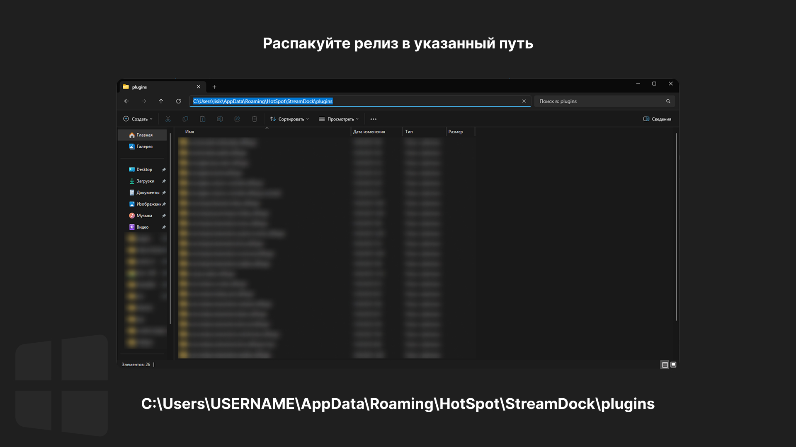

# Wled Controller Ajazz Plugin


Плагин для управления приложением Wled с помощью Ajazz или MiraBox и других устройств StreamDock.

## Возможности

### Кнопки
- **On/Off** - Включение и выключение подсведки


### Энкодеры (крутилки)
- **Яркость (энкодер)** - вращение: изменение яркости подсветки

### Панель настроек

Панель доступна по адресу **http://127.0.0.1:17895/**.
Настройки можно открыть и напрямую по ссылке: **http://127.0.0.1:17895/**. StreamDock и плагин должны работать. Если порт занят, актуальный адрес доступен в логах плагина.
Настройки сохраняются автоматически. Уведомления показывают результат действий и подтвержденного сохранения. Если процесс плагина остановился, появляется экран с кнопкой **«Обновить»**.

## Совместимость

### Клавиатуры
- Ajazz AKP153
- Ajazz AKP05 (с энкодерами)
- Mirabox N4

### Системы
- Windows 11 24H2
- Windows 10

## Установка

Скачайте последний релиз на [GitHub Releases](https://github.com/MrFlit/Wled-Controller-Ajazz-Plugin/releases).

При обновлении полностью закройте StreamDock, замените папку плагина и запустите StreamDock заново.

<details>
<summary>Windows</summary>

1. Распакуйте папку плагина по пути:
   ```
   C:\Users\USERNAME\AppData\Roaming\HotSpot\StreamDock\plugins
   ```
   
   
2. Откройте StreamDock и настройте кнопки


## Обратная связь

- [Сообщить о баге](https://github.com/MrFlit/Wled-Controller-Ajazz-Plugin/issues/new?template=bug_report.yml)
- [Предложить улучшение](https://github.com/MrFlit/Wled-Controller-Ajazz-Plugin/issues/new?template=feature_request.yml)
- [Поставить звезду](https://github.com/MrFlit/Wled-Controller-Ajazz-Plugin)

## Напоминание

> Пожалуйста, при создании плагинов под другие устройства и форков указывайте оригинальный репозиторий: [whxtelxs/Yandex-Music-Ajazz-Plugin](https://github.com/whxtelxs/Yandex-Music-Ajazz-Plugin).
